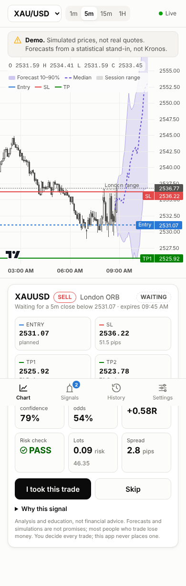
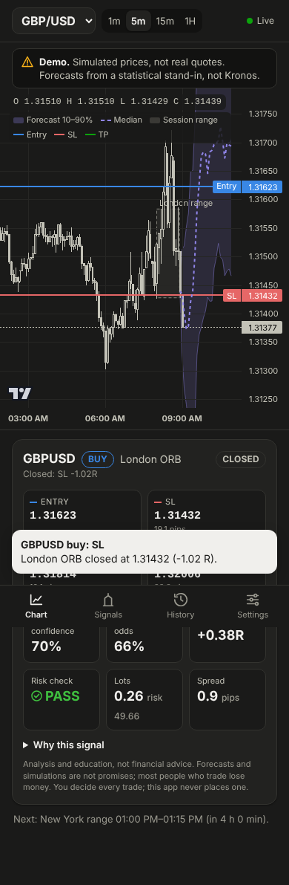

# Forex Trading Analysis App

For each forex setup, the app shows a possible **entry, stop loss (SL) and take
profit (TP)**, with a confidence score. It combines two open-source projects:
**Kronos** (this repo: a pre-trained model that forecasts candles) and
**day-trader-skill** (setup rules, the Time Machine simulator and a risk check,
ported here to forex).

> Analysis and education, not financial advice. Forecasts and simulations are
> not promises, and most people who trade lose money. The app never places a
> trade: the trader decides every one.

| A waiting signal (light) | A closed signal (dark) |
| --- | --- |
|  |  |

*Screenshots from the demo: a simulated market and a statistical stand-in model, not Kronos.*

## Use it with live prices, privately, on your own computer

The app runs on your computer and only you can open it. Prices stream live
while it runs: Yahoo Finance (free, no account) or your OANDA practice
account (free, real broker prices).

1. **Download** the app:
   [Download ZIP](https://github.com/MinnPhyoe/Kronos/archive/refs/heads/claude/sweet-hypatia-7v3qxy.zip),
   unzip it, and open the `forex-app` folder inside.
2. **Install Python 3.10 or newer** from [python.org](https://www.python.org/downloads/).
   On Windows, tick **"Add python.exe to PATH"** in the installer.
3. **Start it.** On Windows, double-click `start.bat`. On Mac or Linux, open
   a terminal in `forex-app` and run:
   ```bash
   ./start.sh
   ```
   The first time, it installs what it needs and asks a few questions: where
   prices come from, which pairs, a password, whether to install the Kronos
   AI model (about 1 GB), and, if you like, a topic name for phone alerts
   through the free [ntfy](https://ntfy.sh) app, which arrive even when the
   app isn't open. Then your browser opens the app. The first
   start loads about 30 days of history, which takes a minute or two.
4. **Next time**, just start it again the same way. Signals only appear
   while it is running, so keep the computer awake during the sessions you
   trade (London 08:00, New York 08:00).

**Privacy**

* With no password, only this computer can open the app.
* With a password, the app asks for it on every new device, and it also
  works from your phone on the same Wi-Fi: open the address printed when it
  starts. After 10 wrong passwords, that device waits 10 minutes.
* To reach it from your phone anywhere, without opening it to the internet,
  install the free [Tailscale](https://tailscale.com/download) app on the
  computer and the phone, sign both into the same account, and open
  `http://<your-computer-name>:8000`.
* Your settings, keys and password stay in `forex-app/.env` on your
  computer. That file is never uploaded.

**Good to know**

* Yahoo prices are free and unofficial. They can lag a few seconds, and
  Yahoo can slow down very frequent requests. Yahoo has no spot gold, so
  XAUUSD shows COMEX gold futures, a few dollars away from spot. For real
  bid/ask prices and spot gold, choose OANDA in setup.
* On a normal computer without a GPU, a Kronos forecast takes from a few
  seconds to about a minute. If your computer struggles, add
  `FOREX_CHART_FORECASTS=false` to `.env`. Signals still get their forecast,
  but the chart band only updates when there is a setup.
* To change your answers, run `python -m forexapp.setup` (inside the
  `.venv`), or edit `.env`.

## Try it in two minutes (no keys, no GPU)

```bash
cd forex-app
pip install -r requirements.txt
python -m forexapp.run all --demo
```

Open http://localhost:8000. The demo runs a **simulated market** on a fast clock
(30x). It starts at 06:30 London on the latest weekday, so the London opening
range forms about 3 minutes after launch. Without `torch` installed, forecasts come from a
**statistical stand-in labelled "bootstrap (not Kronos)"**. The app says so in a
banner, and nothing the stand-in shows says anything about Kronos.

Run the tests (offline, about 1 second):

```bash
pip install -r requirements-dev.txt
python -m pytest -q tests
```

## How data flows

```
provider ticks ──► feed ──► 1m candles ──► 5m / 15m / 1H ──► store (SQLite or TimescaleDB)
                    │                                 │
                    └── ticks (≤4/s) ─┐               └── "candle closed" ──► strategy ──► forecast request
                                      ▼                                          ▲              │
                                 API + WebSocket ◄── signals, forecasts, alerts ─┘              ▼
                                      │                                                 model (Kronos, GPU)
                                      ▼
                           phone-first web app (chart, signal card, alerts)
```

1. A forex data provider streams live prices (ticks) to the feed service.
2. The feed builds 1m candles and rebuilds 5m, 15m and 1H from them, saves them,
   and publishes "candle closed".
3. At each 5m close, the strategy service checks for a setup (session
   opening-range breakout, ported from day-trader-skill).
4. When a setup appears, the model service runs 30 Kronos forecast paths and
   the Time Machine estimates the odds.
5. The signal engine sets entry, SL and TP and runs the risk check (PASS or BLOCK).
6. The API pushes candles, forecasts and signals to the app over its own WebSocket.
7. The trader sees the chart and the signal card and decides.

The services talk over an in-process bus (`run all`) or Redis (separate
containers, `docker compose up`).

## The phases, in code

| Phase | Where | Run it | Done when |
| --- | --- | --- | --- |
| 0 Setup | `requirements*.txt`, `.env.example`, this layout | `python -m forexapp.run all --demo` | Kronos runs a sample forecast (`examples/prediction_example.py`) |
| 1 Data pipeline | `forexapp/data/` (providers, candle builder, store, history, validate) | `python -m forexapp.data.history download --years 2` | 2+ years stored, live candles updating, `validate compare` within 1-2 pips |
| 2 Kronos baseline | `forexapp/models/kronos_service.py`, `evaluate.py` | `python -m forexapp.models.evaluate --pair EURUSD --days 90` | real close inside the 10-90% band about 80% of the time |
| 3 Port day-trader-skill | `forexapp/strategy/` (sessions, scanner, exits, timemachine, sizing, risk, news, alerts) | `pytest tests/test_strategy.py` | scanner, entry, exit and risk work on forex |
| 4 Signal engine | `forexapp/signals/engine.py` | `pytest tests/test_signals.py` | JSON signal with entry, SL, TP and confidence |
| 5 Backtest | `forexapp/backtest/` | `python -m forexapp.backtest --versions rules,base` | positive expectancy after costs, out of sample |
| 6 Fine-tune Kronos | `forexapp/models/finetune/prepare_data.py` + Kronos `finetune_csv/` | see below | fine-tuned beats base in the backtest |
| 7 Full potential | volatility, synthetic data, multi-timeframe, regime, results log, Claude explanations | `FOREX_*` flags below | each one backtested before going live |
| 8 Backend API | `forexapp/api/server.py`, `forexapp/run.py`, `docker-compose.yml` | `python -m forexapp.run all` | the app receives live data and signals |
| 9 App frontend | `app/` (web app, installable on a phone) | open http://localhost:8000 | chart, signal card and alerts on a phone |
| 10 Launch and monitor | `forexapp/monitor.py`, `scripts/retrain.sh` | `python -m forexapp.monitor report` | results log and monthly retraining running |

### Phase 1: data

Pick one provider and stick with it. Training, backtests and live signals must
all use the same candles. Set `FOREX_PROVIDER` and its key in `.env`:

| provider | live | history | key |
| --- | --- | --- | --- |
| `yahoo` | 1m chart read every 5 s (free, unofficial, can lag) | last ~30 days of 1m | none |
| `oanda` | streaming API (real broker prices) | M1 bid/ask candles from the same account | `OANDA_TOKEN`, `OANDA_ACCOUNT` |
| `eodhd` | WebSocket | intraday 1m (no spread: the pair's typical spread is used) | `EODHD_API_KEY` |
| `tradermade` | WebSocket | minute time series | `TRADERMADE_API_KEY` |
| `simulated` | generated | generated | none (development only) |

```bash
python -m forexapp.data.history download --pairs EURUSD,GBPUSD,USDJPY,XAUUSD --years 2
python -m forexapp.data.history import-histdata EURUSD DAT_ASCII_EURUSD_M1_2024.csv   # free HistData.com files (EST)
python -m forexapp.data.history info
python -m forexapp.data.validate gaps --pair EURUSD --days 30
python -m forexapp.data.validate compare --pair EURUSD --days 7 --against oanda     # or a broker CSV
```

Candle rules, fixed once: UTC timestamps; a candle belongs to the minute it
starts; bid prices (or mid, `FOREX_PRICE_BASIS`), spread stored separately;
volume = tick count; weekend gaps are reported, never filled. The feed
reconnects with backoff and backfills missed minutes from the provider's history.

### Phase 2: Kronos

Install `requirements-model.txt` (use the CUDA build of torch on a GPU). The
wrapper loads `NeoQuasar/Kronos-Tokenizer-base` + `NeoQuasar/Kronos-small` once.
It feeds the last 480 closed candles (with `amount` = 0, as in the
fine-tuning data) and gets 24 candles ahead, skipping the weekend close. It
runs 30 paths with `sample_count=1, T=1.0, top_p=0.9` and keeps every path.
All 30 go through one `predict_batch` call, so it is one batched forward
pass rather than 30 `predict` calls. A forecast returns the median close, the
10th/90th percentile of lows/highs (the band on the chart), the 10-90% band of
closes (for calibration), the share of paths ending higher, and all raw paths.

### Phase 3-4: rules and signals

* **Sessions** (`strategy/sessions.py`), each in its own city's time: London
  08:00-08:15, New York 08:00-08:15 (no entries 08:20-08:35, before US data),
  Tokyo 09:00-09:15 for JPY pairs.
* **Entry**: a 5m candle closes beyond the range. A buy fills at the ask
  (level + spread); a sell fills at the bid and its stop and targets are
  checked on the ask. A setup expires 90 minutes after the range.
* **Stop**: range midpoint (or far side) plus one spread. At least 0.5 x ATR(14).
  Kronos check: if the stop is above the 10th percentile of the paths' lowest
  lows, it widens to beyond that level, or the setup is skipped when that needs
  more than 3 x ATR.
* **Targets**: TP1 = 1R; TP2 = the level half the forecast paths reach, capped
  at 3R. No signal if that is short of 1R.
* **Confidence**: the share of paths that hit TP1 before SL. Time Machine
  odds: TP1-first among replays that hit a side (2,000 replays, seed 19).
  Expectancy is in R, after slippage and commission.
* **Filters** (all must pass): forecast available, plan holds, confidence ≥ 55%,
  Time Machine at or above break-even, expectancy > 0, risk check PASS.
* **Risk check** (`strategy/risk.py`): max loss per trade, daily loss limit,
  trades per day, reward:risk, session window, quiet window, last hour before
  the Friday close, high-impact news for either currency, spread over 2x normal,
  duplicates, setups paused by the monitor.
* **Sizing** (`strategy/sizing.py`): lots = max loss / (stop pips x pip value),
  rounded down to 0.01; capped by max lots and leverage.

Every signal is logged, shown or filtered, and followed to its outcome (TP1,
SL, or the time exit after the horizon). That log is the results log. Signal JSON:

```json
{"pair": "EURUSD", "side": "buy", "setup": "London ORB", "status": "waiting",
 "entry": 1.0852, "sl": 1.0838, "tp1": 1.0866, "tp2": 1.0881,
 "kronos_confidence": 0.67, "timemachine_odds": 0.61, "expectancy_r": 0.28,
 "risk_check": "PASS", "lots": 0.35,
 "forecast_band": [{"time": "...", "p10": 1.0841, "p50": 1.0858, "p90": 1.0874}],
 "created_at": "2026-11-09T08:20:00Z", "filters": [...], "timemachine": {...}, "risk": {...}}
```
(illustrative numbers)

### Phase 5: backtest

```bash
python -m forexapp.backtest --pairs EURUSD,GBPUSD --versions rules,base --train-days 365 --test-days 91
```

Walk-forward: thresholds are picked on each training window and reported
**only** on the following test window. No look-ahead: the forecast input ends
at the trigger candle, and entries fill at the next candle's open plus spread
and slippage. A candle touching both SL and TP counts as SL. The report
(`reports/backtest.md` and `.json`) compares rules alone against rules + base
Kronos against rules + fine-tuned Kronos. It shows expectancy, profit factor,
max drawdown, win rate, trades/month, calibration and a pair-and-session
breakdown, plus the pass criteria. Forecasts are cached in the database, so
reruns are fast.

### Phase 6: fine-tuning

```bash
python -m forexapp.models.finetune.prepare_data --pairs EURUSD,GBPUSD,USDJPY,AUDUSD,XAUUSD \
    --train-end 2024-12-31 --val-end 2025-06-30 --chain
cd .. && python finetune_csv/train_sequential.py --config forex-app/models/finetune/data/EURUSD_5m_config.yaml
```

The data is split by time, and the test period goes to a separate, untouched
CSV. `finetune_csv` sorts rows by time, so pairs can't share one CSV. `--chain`
makes each pair continue from the previous pair's checkpoint, giving one model
across pairs; without it you get one model per pair. Try both. Point
`KRONOS_CHECKPOINT` / `KRONOS_TOKENIZER_CHECKPOINT` at the result and rerun
`evaluate` and the backtest with `--versions rules,base,finetuned`. Keep the
base model as the fallback.

### Phase 7: extras (off by default; switch on one at a time after a backtest)

| flag | what it does |
| --- | --- |
| results log | always on: every signal and its real outcome (`/signals/history?include_filtered=true`) |
| `FOREX_REQUIRE_HTF=1` | a 1H forecast must point the same way as the 5m signal |
| `FOREX_VOLATILITY_FILTER=1` | forecast ATR from the path spread: widen the stop (smaller lots) above 1.3x, skip above 2x |
| `FOREX_TM_SYNTHETIC=1` | Kronos paths join the Time Machine's pool |
| `FOREX_REGIME_FILTER=1` | skip breakouts on ranging days (efficiency ratio, ATR, 1H forecast slope) |
| `FOREX_EXPLAIN=1` | Claude writes a 2-3 sentence reason after a signal exists (`ANTHROPIC_API_KEY`) |

Claude stays out of the hot path. The explanation is written in a background
task after the numbers are final, and it never changes them. It uses
`claude-opus-5-5` at low effort with server-side refusal fallbacks enabled.

### Phase 8: the API

| endpoint | returns |
| --- | --- |
| `GET /candles?pair=EURUSD&tf=5m&limit=500` | candle history |
| `GET /forecast?pair=EURUSD&tf=5m` | latest band (p10, p50, p90), flagged `stale` if older than the last candle |
| `GET /signals?status=active` | current signals (`include_filtered=true` for all) |
| `GET /signals/history` | past signals, outcomes and stats per setup |
| `POST /signals/{id}/action` | `{"action": "took"}` or `"skipped"`: feeds the results log and the daily limits |
| `WS /stream` | live `candle`, `tick`, `forecast`, `signal`, `alert`, `status` messages |
| `GET /sessions`, `/scan`, `/calendar`, `/stats`, `/monitor`, `/health`, `/pairs`, `GET/PUT /settings` | |

The provider key stays on the server; the app only talks to this API. Login:
`FOREX_AUTH_MODE=token` (one shared token) or `supabase` (verifies Supabase
Auth access tokens; the WebSocket takes `?token=`). Ticks go out at most 4
times a second per pair. If the model is down, candles keep streaming and
signals are marked unavailable.

Hosting: `docker compose up --build` runs TimescaleDB, Redis, feed, strategy,
API and the model service. Uncomment the GPU block for the model.

### Phase 9: the app

A phone-first web app (installable as a PWA) on TradingView Lightweight Charts:

* pair and timeframe picker; live candles from the WebSocket; the forecast band
  (10-90% shaded, dashed median); the session range box; entry (blue), SL (red)
  and TP1/TP2 (green) lines;
* signal card with status, levels and pips, Kronos confidence, Time Machine
  odds, expectancy, PASS/BLOCK, lots for your max loss, the reason, and the
  "I took this trade" / "Skip" buttons;
* Signals (active signals, scanner, economic calendar), History (outcomes and
  stats per setup, optionally every filtered signal), Settings (account size,
  limits, pairs, sessions, theme, alerts);
* alerts in the app, as browser notifications, and optionally to phones through
  a webhook or [ntfy](https://ntfy.sh) (`FOREX_NTFY_TOPIC`).

### Phase 10: launch and monitor

Launch in stages: forward test on demo for 4-8 weeks, then a private beta,
then go public only if live results stay close to the backtest.

```bash
python -m forexapp.monitor report --days 7 --backtest reports/backtest.json
TRAIN_END=2026-06-30 VAL_END=2026-09-30 scripts/retrain.sh
```

The weekly report covers live expectancy and win rate per pair and setup
against the backtest, calibration, the forecast band hit rate, feed
disconnects, missed candles and model run time. Every hour the strategy
service pauses a pair and setup whose last 20 shown signals average below
-0.2R, and sends an alert. Resume it in Settings. `retrain.sh` adds new data,
fine-tunes, evaluates and backtests. It never deploys: switch the checkpoint
only if the new model wins.

## Adding a third strategy

A new setup plugs into the same pipeline. Add its detection next to
`strategy/scanner.py` (a function returning the range/levels and an entry
state). Call it from `StrategyService.on_5m_close`, and give `plan_exit` its
structural stop. The forecast filter, Time Machine, risk check, results log,
backtest and app work unchanged. Its rules (entry, stop, timeframe, pairs) are
still an open question in the guide.

## Choices made where the guide left room

* **Kronos stop check window.** "The 10th percentile of forecast lows" over the
  whole 2-hour horizon sits 5-10 ATR away for any model, which would reject
  every setup. The check therefore looks at the paths' first 6 candles (30
  minutes). Tune `FOREX_STOP_CHECK_BARS` / `_PCT` in the backtest.
* **"The level the median path reaches"** is the median of each path's best
  level within the horizon: the level half the paths reach. The per-step
  median line is too smooth to reach anything.
* **Spread.** Candles are bid. A buy pays the spread at entry, a sell pays it
  at exit (its stop and targets are checked on the ask). The cost matches the
  guide's "± spread" and avoids counting the spread twice.
* **Gold** uses 1 pip = 0.10 and 1 lot = 100 oz. Brokers differ; check yours.

## What was and wasn't run here

* Tested: the candle builder and aggregation, sessions across DST, the
  scanner, exits, sizing, risk, Time Machine, the signal engine, the strategy
  service end to end (range to waiting to triggered to TP1), the backtest (no
  look-ahead, next-open fills, walk-forward), the API, the password login and
  lockout, the Yahoo feed path and the real Kronos code (67 tests). The full
  demo also ran in a browser, and so did a password-protected run with live
  Yahoo-format prices, and a run with Kronos as the forecast model.
* Kronos: the wrapper ran on the real Kronos code (an untrained model saved
  and loaded like a fine-tuned checkpoint), so loading, batching and
  timestamps are checked. The trained weights come from Hugging Face, which
  the build environment couldn't reach, so forecast quality and speed with
  Kronos-small are untested. Run `python -m forexapp.models.evaluate` once
  on your machine before trusting it.
* Yahoo, OANDA, EODHD and TraderMade were not reachable from the build
  environment. The Yahoo client was tested against Yahoo's published answer
  format; the others follow their public docs. The first real start shows
  whether prices arrive. Start with
  `validate compare` against your broker.
* The economic calendar default is a free, unofficial ForexFactory-format feed
  that can change. A local file (`FOREX_CALENDAR_FILE`) works too.
* The Docker images were not built here (no Docker daemon).

## Legal notes (not legal advice)

Present signals as analysis and education, with a clear risk warning. In the
UK, giving personal investment advice or managing trades for others is
regulated by the FCA. Keep the app as decision support, where the user
chooses every trade, and check with a regulatory lawyer before charging money
or adding auto-trading. Never claim a guaranteed win rate; show the real
tracked results from the results log instead.

## Layout

```
forex-app/
  forexapp/data/       provider clients, candle builder, store, history, validation
  forexapp/models/     Kronos wrapper, demo stand-in, model service, evaluation, fine-tuning prep
  forexapp/strategy/   sessions, scanner + entry, exits, Time Machine, sizing, risk, news, alerts, regime
  forexapp/signals/    signal engine, Claude explanations
  forexapp/backtest/   walk-forward tests and reports
  forexapp/api/        FastAPI server and WebSocket, auth
  forexapp/monitor.py  weekly report, auto-pause
  app/                 the web app (no build step)
  tests/               offline tests
```

Sources: [Kronos](https://github.com/shiyu-coder/Kronos) ·
[Kronos models](https://huggingface.co/NeoQuasar) ·
[day-trader-skill](https://github.com/Jakeschincariol/day-trader-skill) ·
[TradingView Lightweight Charts](https://github.com/tradingview/lightweight-charts) (Apache 2.0, vendored in `app/vendor/`).
